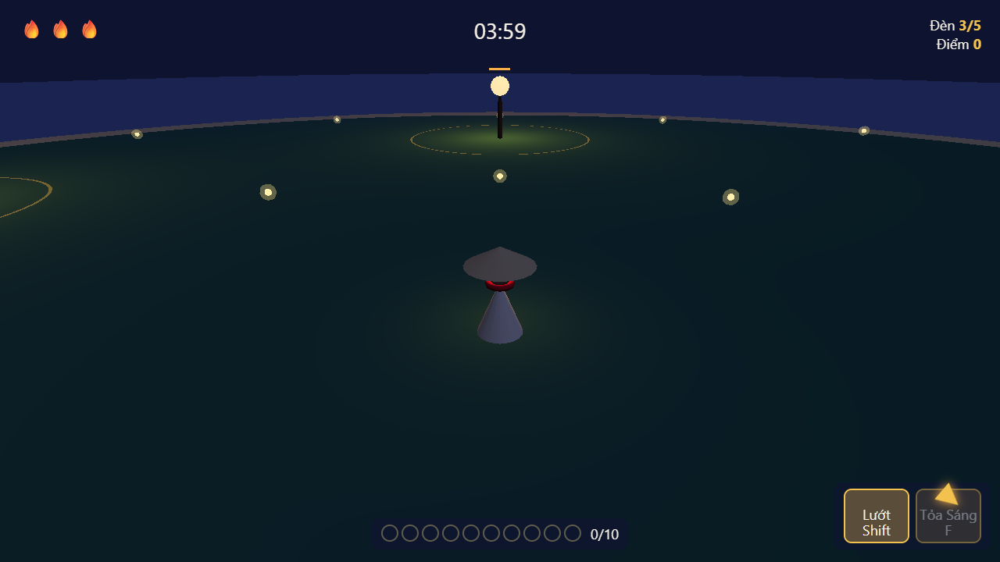

# Đảo Đèn Lồng

> **Video demo:** [Release v1.0.0](https://github.com/Chill2004/K5-L3A-DAY12-NguyenTheCuong-2A202603355-AI-SDLC-Dao-Den-Long/releases/tag/v1.0.0) (file `demo.mp4`)
> Bài Lab Day 12 AI SDLC: Nguyễn Thế Cường, 2A202603355. Đề bài: [docs/lab/](docs/lab/README.md). Retro: [docs/notes/retro.md](docs/notes/retro.md).

Game 3D góc nhìn thứ ba: Mây, người giữ đèn nhỏ tuổi, gom đom đóm để thắp và **giữ** các Đèn Lồng Lớn sáng tới bình minh
trên ba hòn đảo (Đảo Bến, Đảo Cau, Đảo Chuông), né Bóng Mực và Gió Lạc. TypeScript + Three.js; logic game tách riêng,
chạy được headless theo **Test Contract v1.3**.



## Yêu cầu hệ thống
- **Node.js ≥ 20** (đã thử với Node 22 trên CI Ubuntu/macOS và Node 24 trên Windows 11).
- Trình duyệt có WebGL2 (Chrome, Edge, Firefox, Safari mới). **Bench cần Google Chrome/Chromium** (tự tìm, hoặc đặt biến `CHROME=<đường dẫn>`).
- macOS, Linux hoặc Windows. GPU tích hợp là đủ (Intel UHD: bench khoảng 190 FPS trung bình).

## Cài đặt và chạy (3 lệnh)

```bash
git clone https://github.com/Chill2004/K5-L3A-DAY12-NguyenTheCuong-2A202603355-AI-SDLC-Dao-Den-Long.git && cd K5-L3A-DAY12-NguyenTheCuong-2A202603355-AI-SDLC-Dao-Den-Long
npm ci && npm run build
node scripts/serve.mjs        # mở http://localhost:4173
```

Bản phát hành: tải `dao-den-long-v1.0.0-web.zip` ở [Release v1.0.0](https://github.com/Chill2004/K5-L3A-DAY12-NguyenTheCuong-2A202603355-AI-SDLC-Dao-Den-Long/releases/tag/v1.0.0).
Đó là thư mục web tĩnh: giải nén rồi phục vụ bằng bất kỳ web server tĩnh nào (vd. `npx serve dist`). Bảng xếp hạng khi đó lưu trong trình duyệt.

## Điều khiển (đổi được trong Cài đặt → Đổi phím)

| Phím mặc định | Hành động |
|---|---|
| W A S D | Di chuyển (theo hướng camera) |
| Space | Nhảy |
| Shift trái | Lướt (14 m/s trong 0.2 s, hồi chiêu 1.5 s) |
| E | Thắp đèn (10 đom đóm, thắp lại 5) / châm dầu đèn đang sáng |
| F | Tỏa Sáng: tốn 3 đom đóm, làm choáng và đẩy lùi Bóng Mực trong 5 m |
| Kéo chuột / ← → | Xoay camera |
| Esc | Tạm dừng: Tiếp tục / Chơi lại Đêm / Cài đặt / Về menu |

Cài đặt (được lưu): âm lượng, độ nhạy chuột, **đổi phím** (báo trùng phím, có Khôi phục mặc định), bảng màu dễ phân biệt,
**giảm chuyển động** (tắt rung camera và chớp màn hình), **chữ lớn ×1.25**. Phụ đề cho: Bóng Mực xuất hiện (kèm mũi tên ở mép màn hình), gió sắp thổi, 10 giây cuối, đèn sắp cạn dầu.

## Luật chơi (Ticket-03)
- 3 Đêm: Đảo Bến (5 đèn, 240 s), Đảo Cau (6 đèn, 270 s), Đảo Chuông (7 đèn, 300 s).
- Đèn sáng có **dầu 100**, hao 1/s; Bóng Mực hút 5/s khi đèn yếu (dầu < 30, mất vùng an toàn). Hết dầu thì đèn tắt.
- **Thắng** khi còn sống lúc bình minh và ≥ 60% số đèn đang sáng. Hết 3 Ngọn Lửa thì thua.
- Sức chứa đom đóm 10 + 2 mỗi lần thắp thành công (tối đa 20).
- Điểm: +5 mỗi đom đóm nạp/châm, +100 thắp lần đầu, +40 thắp lại, +5 mỗi Bóng Mực trúng Tỏa Sáng (+15 nếu nó đang hút dầu);
  khi thắng: mỗi đèn sáng +50 + dầu còn lại, mỗi Ngọn Lửa +50.
- **Bảng xếp hạng** top 10 (menu chính): nhập tên sau Bình Minh hoặc sau khi thua. Tên 3–12 ký tự, hỗ trợ tiếng Việt có dấu.

## Test, headless, bench, soak

```bash
npm test                         # Vitest: 52 test (unit + 34 scenario headless + tất định + bench/leaderboard)
npm run verify -- phase-4        # CLI thật: mọi scenario chạy 2 lần, mã thoát, hiệu năng; ghi docs/proof/phase-4/
node build/headless/cli.js --seed 1 --night 2 --ticks 600 --out out.jsonl [--scenario f.json] [--inputs f.json]
node scripts/bench.mjs --seed 42 --duration 30 --out bench.json      # bench_cmd
node --expose-gc --jitless build/headless/soak.js --seed 7 --nights 10 --out soak.json   # soak_cmd
node scripts/serve.mjs --export-leaderboard out.json                 # xuất bảng xếp hạng {"entries": [...]}
```

Khai báo đầy đủ ở [`game.contract.json`](game.contract.json) (v1.3: `build_cmd`, `run_cmd`, `headless_cmd`, `bench_cmd`, `soak_cmd`, `tuning`).

- **Bench:** mở Chrome ở **cửa sổ** (không toàn màn hình) với vùng vẽ đúng 1280×720, **vsync tắt** bằng `--disable-gpu-vsync --disable-frame-rate-limit`,
  chạy cảnh chuẩn (Đêm 1, 200 Bóng Mực wander, 100 đom đóm, L1–L3 sáng, camera bay vòng r = 30 m, Y = 15 m, 15 s/vòng), 3 s khởi động rồi đo.
  `peak_mem_mb` là `null`: bản web chạy trên nhiều tiến trình Chrome nên không đo RSS thống nhất được (có thêm `js_heap_peak_mb`). Không có màn hình thì thêm `--headless`.
- **Soak:** 10 Đêm (1 → 2 → 3 xoay vòng) trong một tiến trình, Đêm thứ i dùng seed 7 + i, input ngẫu nhiên theo seed.
  Chạy với `--jitless`: có JIT thì RSS tăng khoảng 25% do bộ nhớ mã JIT của V8 (không phải rò rỉ: 60 Đêm không tăng hơn 10 Đêm), xem [proof](docs/proof/phase-4/README.md).
- **Bảng xếp hạng** lưu ở `.data/leaderboard.json` (đổi bằng biến `DDL_DATA_DIR`) khi chạy bằng `node scripts/serve.mjs`.

Kết quả tự đo (Windows 11, i7-10750H, Intel UHD): [bench.json](docs/proof/phase-4/bench.json) avg 192.6 FPS · p1-low 38 · load 2.5 s;
[soak.json](docs/proof/phase-4/soak.json) 0 crash, RSS 42.7 → 44.1 MB.

CI (GitHub Actions) chạy build, test, verify trên Ubuntu và macOS mỗi lần push.
Bằng chứng: [Phase 1](docs/proof/phase-1/README.md) · [Phase 2](docs/proof/phase-2/README.md) · [Phase 3](docs/proof/phase-3/README.md) · [Phase 4](docs/proof/phase-4/README.md).
Ghi chép: [giả định](docs/notes/assumptions.md) · [nhật ký AI](docs/notes/ai-log.md) · [ADR](docs/adr/) · [CHANGELOG](CHANGELOG.md).

## Cấu trúc

```text
src/core/       logic thuần: sim (tick 60 Hz, RNG có seed), maps, bench, leaderboard
src/headless/   CLI headless, soak, kiểm tra đầu vào, ghi JSONL
src/render/     Three.js (world.ts), luồng 3 Đêm + HUD + phụ đề (main.ts), âm thanh, cài đặt, client bảng xếp hạng
scripts/        serve.mjs (run_cmd + API bảng xếp hạng), bench.mjs, verify.mjs, gen-scenarios.mjs, measure-fps.mjs
scenarios/      scenario headless (kỳ vọng tính tay) · tests/ Vitest
CLAUDE.md, .claude/   harness AI: hướng dẫn, hook Stop chặn khi test đỏ, skill verify
```

## Sáng tạo của tôi

Tất cả chỉ nằm ở phần hiển thị (`src/render/`), không có trong core, nên output headless không đổi: `npm test` đạt toàn bộ scenario.
- **Đom đóm bay quanh Mây:** số đom đóm đang mang hiện thành các đốm sáng bay vòng quanh Mây.
- **Vòng sáng an toàn** trên mặt đất đúng bán kính 6 m, tự tắt khi đèn yếu (< 30 dầu).
- **Lời Ông Đăng** riêng cho từng Đêm; nhạc nền ngũ cung và hiệu ứng âm thanh tự tổng hợp bằng WebAudio.
- Đom đóm bị rơi nhấp nháy 2 s cuối trước khi biến mất; camera rung nhẹ khi bị đánh (tắt được bằng "Giảm chuyển động").

## Giấy phép
Mã nguồn: [MIT](LICENSE). Nguồn thư viện, âm thanh, công cụ AI: [CREDITS.md](CREDITS.md).
